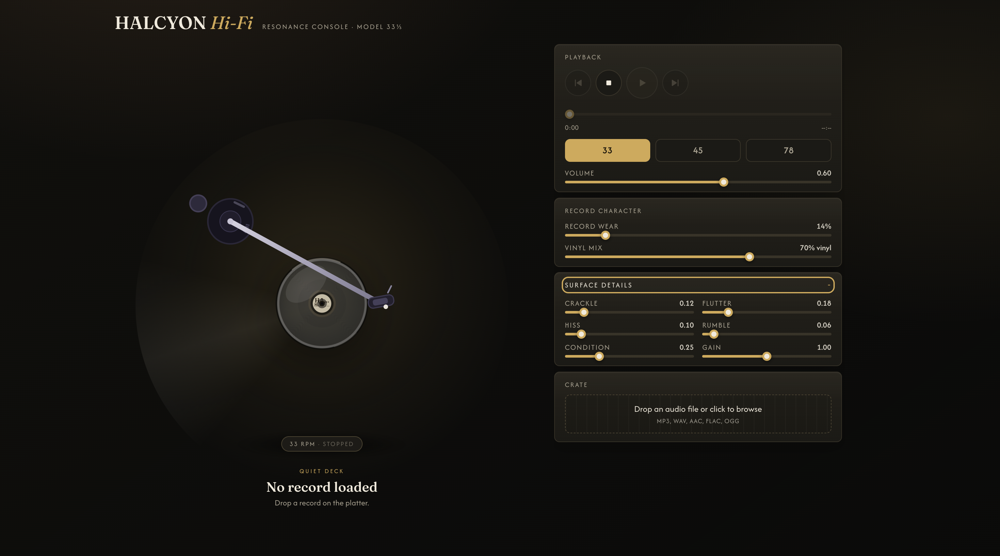

#  Vinyl Player

A web music player whose UI is a **spinning vinyl / turntable**, where the audio
itself is processed in real time through an **AudioWorklet DSP chain that makes
it sound like it's coming off a record** — rumble, wow & flutter, surface hiss,
crackle and pops, gentle analog saturation, and a speed-dependent high-frequency
roll-off.

Load a track, drop the stylus, and hear it warm up like vinyl.



---

## Quick start

```bash
npm install
npm run dev
```

Then open **http://localhost:5173** and drop an audio file onto the deck
(MP3 / WAV / AAC / FLAC / OGG).

```bash
npm run build     # strict tsc type-check + production bundle -> dist/
npm run preview   # serve the production build
npm run test:dsp  # run the vinyl DSP in Node (no browser needed)
```

---

## What it does

| Feature | Implementation |
|---|---|
| Spinning platter | Canvas-rendered vinyl, rotation driven by `usePlatterAnimation` (spring spin-up, coast-to-stop decay) |
| Tonearm + cueing | SVG arm that lowers the stylus when you press play (`stylusPosition` state) |
| Vinyl sound | `public/vinyl-processor.js` — a real `AudioWorkletProcessor` |
| Live controls | 33 / 45 / 78 RPM, vinyl condition, crackle, wow/flutter, rumble, hiss, warmth, gain, volume |
| Local playback | `AudioBufferSource` → worklet → gain → speakers |

---

## Architecture

```
                 ┌─────────────────────────────────────────────┐
                 │              React UI (Zustand)             │
                 │  Turntable · Platter · Tonearm · Controls    │
                 └───────────────────────┬─────────────────────┘
                                         │ state
                 ┌───────────────────────▼─────────────────────┐
                 │            useVinylDsp (hook)               │
                 │   decode → source → AudioWorkletNode        │
                 └───────────────────────┬─────────────────────┘
                                         │ PCM
                 ┌───────────────────────▼─────────────────────┐
                 │  VinylProcessor  (AudioWorklet, audio thread)│
                 │  wow/flutter → rumble → hiss → crackle →     │
                 │  saturation → stereo width → HF roll-off     │
                 └───────────────────────┬─────────────────────┘
                                         ▼
                                      speakers
```

The store is the single source of truth for player *state*; the hook mirrors it
into the audio graph and reports playback position back.

---

## Project layout

```
vinyl-player/
├── public/
│   └── vinyl-processor.js         # AudioWorkletProcessor (classic script)
├── src/
│   ├── components/
│   │   ├── Turntable.tsx          # scene root
│   │   ├── Platter.tsx            # canvas vinyl + rotation
│   │   ├── Tonearm.tsx            # svg arm / cueing
│   │   ├── Controls.tsx           # transport + knobs
│   │   └── TrackLoader.tsx        # drag-drop / file picker
│   ├── dsp/workletTypes.ts        # shared param contract
│   ├── hooks/
│   │   ├── useVinylDsp.ts         # audio graph wiring
│   │   ── usePlatterAnimation.ts # rAF rotation physics
│   ├── store/playerStore.ts       # Zustand state + actions
│   ├── styles/index.css           # turntable theme
│   ├── App.tsx
│   └── main.tsx
```

---

## The vinyl DSP chain

Each stage mirrors a physical property of record playback:

1. **Wow & Flutter** — pitch modulation from rotational instability. Implemented
   as a variable-rate fractional resampler (ring buffer + LFO-modulated read
   pointer, two summed sine LFOs). This is the hardest stage and the reason a
   plain `<audio>` node can't do the job.
2. **Sub-bass rumble** — low-frequency filtered noise.
3. **Surface noise** — pink-ish filtered noise floor.
4. **Clicks & Pops** — Poisson-scheduled events firing into a 48-impulse bank,
   up to 4 simultaneous voices. Rate scales with crackle + wear.
5. **Saturation** — gentle soft-clip (`d / (1 + |d|)`) for analog warmth.
6. **Stereo width** — subtle mid-side narrowing that increases with wear.
7. **HF roll-off** — low-pass that closes further at higher RPM.

All of these are `AudioParam`s on the node, so the React knobs are real-time
audio controls with no jank. The worklet uses a seeded PRNG (mulberry32) and
allocates nothing inside `process()` — it never touches `Math.random()`.

---

## Scope & roadmap

This is **Phase 1**: the DSP + turntable proof of concept, playing local files.
(The longer engineering assessment and step-by-step walkthrough live in the
local `docs/` folder, which is not tracked in this repo.)

Deliberately **not** here yet (see the assessment for why):

- **Spotify / YouTube playlist import.** Both platforms withhold raw PCM from
  their public APIs, so audio can't be routed through our DSP. The safe product
  path is Spotify/YouTube as a *metadata* source paired with decodable audio —
  that's Phase 2.
- PWA manifest, track matching, cross-track seamlessness.

---

## Engine notes

- The worklet lives in `public/` (not processed by Vite) so it can be loaded as
  a classic script: `ctx.audioWorklet.addModule('/vinyl-processor.js')`.
- Strict TypeScript (`verbatimModuleSyntax`, no unused locals) — `npm run build`
  type-checks before bundling.
- Browsers block audio until a user gesture; the graph resumes on first play.

This template provides a minimal setup to get React working in Vite with HMR and some Oxlint rules.

Currently, two official plugins are available:

- [@vitejs/plugin-react](https://github.com/vitejs/vite-plugin-react/blob/main/packages/plugin-react) uses [Oxc](https://oxc.rs)
- [@vitejs/plugin-react-swc](https://github.com/vitejs/vite-plugin-react/blob/main/packages/plugin-react-swc) uses [SWC](https://swc.rs/)

## React Compiler

The React Compiler is not enabled on this template because of its impact on dev & build performances. To add it, see [this documentation](https://react.dev/learn/react-compiler/installation).

## Expanding the Oxlint configuration

If you are developing a production application, we recommend enabling type-aware lint rules by installing `oxlint-tsgolint` and editing `.oxlintrc.json`:

```json
{
  "$schema": "./node_modules/oxlint/configuration_schema.json",
  "plugins": ["react", "typescript", "oxc"],
  "options": {
    "typeAware": true
  },
  "rules": {
    "react/rules-of-hooks": "error",
    "react/only-export-components": ["warn", { "allowConstantExport": true }]
  }
}
```

See the [Oxlint rules documentation](https://oxc.rs/docs/guide/usage/linter/rules) for the full list of rules and categories.

---

## License

Released under the [MIT License](./LICENSE) — © 2026 reagan-pius
